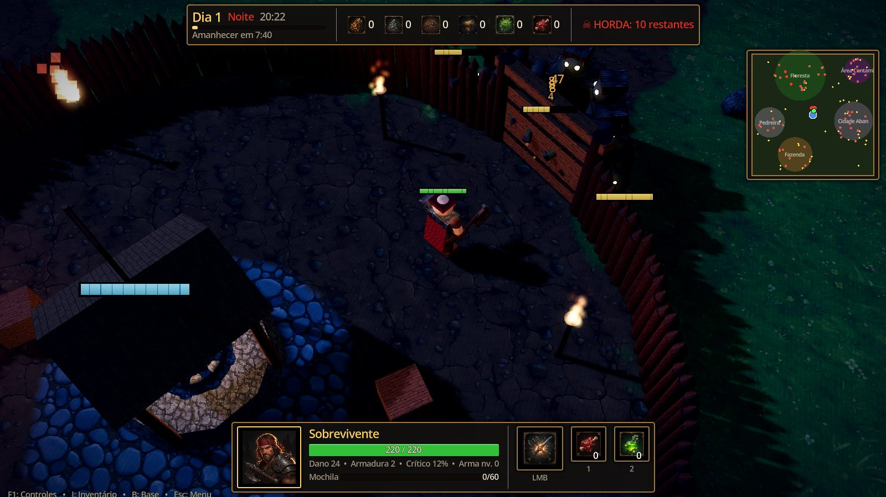

# Horda: Noites de Sobrevivência

Jogo de sobrevivência cooperativa contra hordas de zumbis (estratégia + RPG + defesa de base),
inspirado em *Night of the Dead: Aftermath* (Warcraft III). Feito em **Godot 4.3+ / GDScript tipado**.

> Estado atual: **Fase 1 — protótipo jogável** concluída.
> Arte gerada por IA no estilo Dota 2 / Warcraft III: texturas, retratos, ícones e conceitos na BytePlus ARK (Seedream);
> **modelos 3D texturizados** (herói, zumbis, fortaleza, muralhas, torres, árvores, casas...) via image-to-3D. Veja o pipeline em docs/ARQUITETURA.md.

## Jogar no navegador / celular

**https://horda-five.vercel.app** — abra no celular na horizontal. No Android (Chrome), use
"Adicionar à tela inicial" para jogar em tela cheia como app.

Celular: joystick à esquerda para andar, hexágono das espadas para atacar (mira automática), toque no
chão para ir até lá ou num inimigo para atacá-lo, **E** saqueia, **1/2** curam, pinça para zoom.
Retrato do herói = inventário • **+** nos recursos = menu da base • painel do dia = pausar
(no PC também valem as teclas I, B e Esc). Parâmetros úteis: `?touch=1` força os controles de toque no PC, `?dbg=1` mostra FPS no console.

Cada push no GitHub recompila automaticamente no Vercel (`tools/vercel_build.sh`, ~1 min).

## Como jogar (PC)

1. Abra a pasta no Godot 4.3 (ou mais novo) e pressione **F5**.
2. *Novo jogo* → escolha a dificuldade.

| Controle | Ação |
|---|---|
| WASD | Mover o herói |
| Clique direito (chão / inimigo) | Mover até o ponto / atacar alvo |
| Clique esquerdo ou Espaço | Golpe em arco na direção do cursor (também corta árvores e quebra pedras) |
| E | Saquear caixas, carros e armários |
| 1 / 2 | Comer carne / usar curativo |
| P (ou toque no retrato) | Personagem: distribuir pontos de atributo |
| I ou Tab | Inventário (mochila + armazém) |
| B | Base: reparar muros/núcleo, afiar arma, fabricar curativos |
| G | Construir: barricada, muros de pedra e de ferro, espinhos, torre de arqueiros, balista, canhão e torre elétrica (T gira, clique constrói, botão direito cancela) |
| Q / F / R / T | Habilidades: Golpe Giratório (nv 1), Investida (nv 2), Grito de Guerra (nv 3), Explosão Arcana (nv 5) |
| Roda / Z, X / C | Zoom / girar câmera / centralizar |
| F5 | Salvar (somente de dia; também salva sozinho a cada amanhecer) |
| F8 | [Depuração] avançar período do dia |
| F1 / Esc | Controles / pausa |

**100 hordas:** antes de cada horda há **2 minutos de preparação** (ou toque em "Chamar agora"). A horda
termina quando o último zumbi cai — e já começa a próxima preparação. Elites a cada 5 hordas, **chefe** a
cada 10 (atacando de todas as direções). Vencer a horda 100 = vitória.

**Defesas:** *Balista* (horda 3) atravessa a fila inteira com virotes de 22 m; *Muro de Ferro* (horda 5)
tem 1600 de vida e armadura 9; *Torre de Canhão* (horda 6) lança balas em arco que explodem em área e
atordoam; *Torre Elétrica* (horda 10) dispara um raio que salta por 5 zumbis e os paralisa.

**Equipamentos:** arma, armadura e amuleto, em 11 modelos (machado, espada, lança, adagas, martelo; couro,
malha, placas; amuletos da vida/arcano e anel do caçador) e 5 raridades — *Comum, Incomum, Raro, Épico e
Lendário* — que multiplicam os atributos e somam de 0 a 4 bônus sorteados (dano, velocidade, crítico,
armadura, vida, regeneração, movimento, energia, poder, roubo de vida). O nível do item acompanha a horda.
Chefes sempre largam Raro ou melhor, elites às vezes; caixas e esconderijos também. Na **Forja** (menu da
base, aba Forja) fabrique com recursos — Engenharia aumenta a chance de raridade. Equipe, compare e desmonte
na aba *Equipamento* do personagem (P). Dados em `data/equipment/*.tres`.

**Tecnologias:** aba *Pesquisa* no menu da base — uma pesquisa por vez, com custo e tempo (o relógio corre
inclusive durante a horda), 16 tecnologias em três ramos com pré-requisitos: **Defesa** (muros reforçados,
pontas de aço, recarga, lunetas, munição pesada, muralhas de ferro, pedreiros que consertam sozinhos),
**Economia** (ferramentas, mochilas, saqueadores, coletores que produzem recursos, oficina avançada) e
**Herói** (treinamento, medicina, foco arcano, veterano). Dados em `data/tech/*.tres`.

**Inimigos especiais:** a partir da horda 4 surge o *Zumbi Explosivo* (incha e explode ao alcançar o alvo,
arrasando muros; abatido, explode ferindo os zumbis ao redor), na 7 o *Cuspidor* (cospe ácido de 10 m,
inclusive por cima dos muros, deixando poças corrosivas, e recua se você se aproximar) e na 9 o *Saltador*
(salta até 10 m sobre a presa e pula os muros durante o cerco). Cada estreia é anunciada na tela.

**Coop online (até 4 jogadores):** menu *Jogar em grupo (coop)* → *Criar sala* gera um código de 5 letras
(e um link de convite `?sala=CODIGO`); os amigos entram pelo navegador do celular ou PC com o código. Base,
armazém, construções e pesquisas são compartilhados; cada jogador tem o próprio herói, nível, atributos e
equipamento, e o XP vai para quem matou. Saques no chão são de quem pegar primeiro. O anfitrião simula o
mundo (zumbis, hordas, torres, tempo). Conexão WebRTC direta entre os navegadores, com sinalização pelo
servidor público do PeerJS (sem servidor próprio); em redes móveis muito restritas a conexão pode falhar.
Partidas coop não são salvas. No PC (sem navegador), o coop usa IP + porta 24680 (ENet).

**Habilidades:** gastam **energia** (barra azul, regenera 6/s) e têm recarga. *Golpe Giratório* acerta
tudo ao redor; *Investida* avança 8 m invulnerável atordoando quem estiver no caminho; *Grito de Guerra*
cura 30% da vida e dá +6 de armadura por 8 s; *Explosão Arcana* cai sobre o maior grupo de zumbis
num raio de 14 m e atordoa os sobreviventes. Novas habilidades liberam ao subir de nível. Dados em
`data/skills/*.tres`.

**Atributos:** cada nível dá **3 pontos** (selo "+" dourado no retrato). *Força* +5% dano e +4 de carga;
*Agilidade* +4% velocidade de ataque, +2% movimento e +1% crítico; *Vitalidade* +18 de vida e +0,4 vida/s;
*Inteligência* +8 de energia, +6% poder das habilidades e -2% de recarga; *Engenharia* +6% vida das
construções e +6% dano de torres e armadilhas. *Redistribuir* devolve os pontos por sucata. Valores em
`data/config/attributes.tres`.

**Na preparação:** explore as regiões (Floresta, Pedreira, Cidade Abandonada, Fazenda, Área Contaminada),
mate zumbis, colete madeira/pedra, saqueie e volte à base — a mochila (60 de peso) é guardada
automaticamente ao entrar. Ao entardecer soa o aviso; à noite a horda vem pelas bordas do mapa,
quebra a paliçada e tenta destruir o **Núcleo**. Sobreviva até o amanhecer: o sol queima os zumbis restantes.
Se o herói cair, renasce na base (e a mochila fica no chão onde morreu). Se o Núcleo cair, fim de jogo.

## Som

Efeitos, músicas e ambientes **CC0** do OpenGameArt (créditos em
[assets/sounds/CREDITS.md](assets/sounds/CREDITS.md)), com 3 a 17 variações por efeito sorteadas com leve
variação de tom. Música dinâmica com crossfade: menu, preparação (2 faixas alternadas), horda (2 faixas),
chefe e derrota; ambiente de pássaros de dia, grilos à noite e um ambiente sombrio perto do cemitério.
Volume de Música, Efeitos, Ambiente e Interface no menu de pausa (salvo em `user://settings.cfg`).

## Assets de terceiros (CC0)

Além da arte gerada por IA, o mapa usa pacotes **CC0** baixados do itch.io (créditos em
[assets/third_party/CREDITS.md](assets/third_party/CREDITS.md)): vegetação, pedras e árvores do
*Stylized Nature MegaKit* (Quaternius), cemitério do *Halloween Bits* (Kay Lousberg), objetos de cenário
do *Fantasy Props* e *Medieval Village MegaKit* (Quaternius) e os **esqueletos** animados do *KayKit
Skeletons* + *Character Animations* (Kay Lousberg), que entram na horda: *Esqueleto* (horda 2),
*Ladino* (5), *Guerreiro* (8) e *Mago* (12, ataca de longe). Também: **escolha de herói** no "Novo jogo"
(Caçador original + Cavaleiro, Bárbaro, Maga, Patrulheiro, Ladina e Encapuzado do *KayKit Adventurers*),
**sobreviventes** animados na base (ferreiro, vigias, conversa, andarilho — *Modular Character Outfits* +
*Universal Base Characters* + *Universal Animation Library*, Quaternius), que se escondem na fortaleza
durante a horda, e **ruínas** do *KayKit Dungeon Pack* na cidade, pedreira e floresta. Para baixar de novo:

```bash
python3 tools/itch_fetch.py /tmp/itch quaternius/stylized-nature-megakit kaylousberg/kaykit-skeletons ...
python3 tools/import_third_party.py /tmp/itch/extraido      # copia só os modelos usados
godot --headless --script res://tools/bake_kaykit.gd         # esqueletos e heróis com armas e animações
godot --headless --script res://tools/bake_npcs.gd           # sobreviventes (cabeça + roupa + cabelo + animações)
xvfb-run godot res://tools/render_portraits.tscn            # retratos dos heróis
```

## Testes

```bash
# Teste automatizado da Fase 1 (gera o mundo, combate, coleta, saque, serviços, noite, amanhecer, save)
godot --headless res://tests/smoke_test.tscn

# Capturas de tela (precisa de display; no Linux sem GPU: xvfb-run + OpenGL)
xvfb-run godot --rendering-driver opengl3 --rendering-method gl_compatibility res://tests/screenshot.tscn -- /tmp/shots
```

```bash
# Coop: anfitrião e cliente em dois processos (ENet local)
GODOT=godot tools/run_coop_test.sh
```

## Regenerar arte e sons

```bash
ARK_API_KEY=... python3 tools/gen_image.py tools/art_prompts.json   # só gera o que estiver faltando
python3 tools/oga_fetch.py /tmp/oga <slugs...>                      # sons/músicas CC0 do OpenGameArt (confere a licença)
python3 tools/build_audio.py /tmp/oga                                # converte para assets/sounds, music, ambient
```



Veja [docs/ARQUITETURA.md](docs/ARQUITETURA.md) para a arquitetura e o roteiro das próximas fases.
