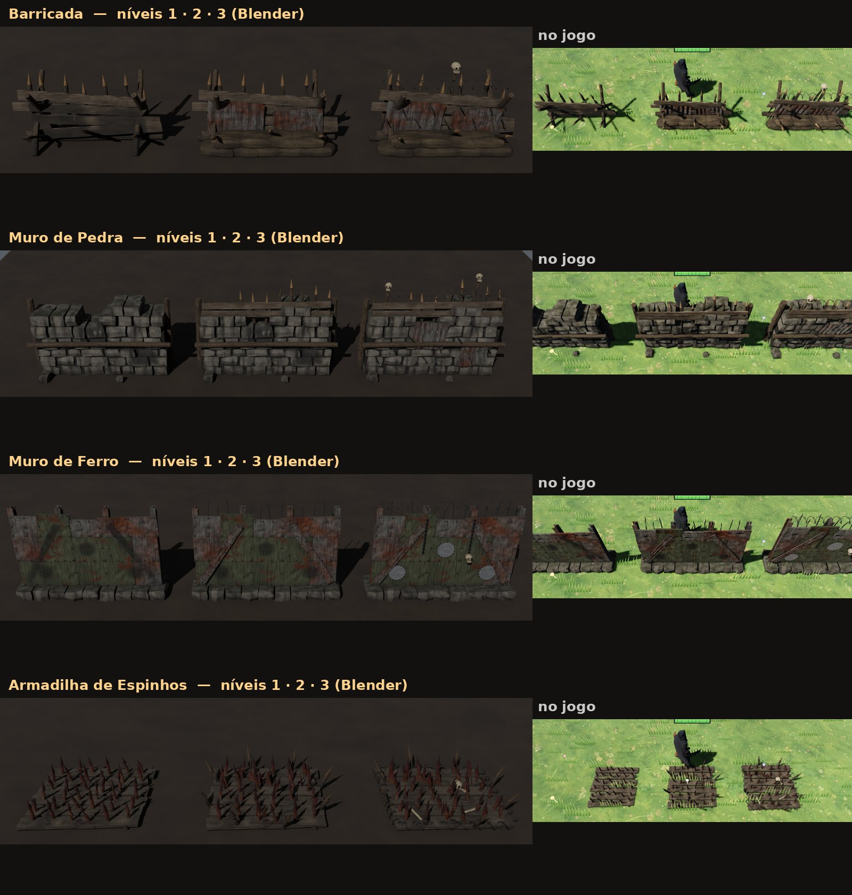
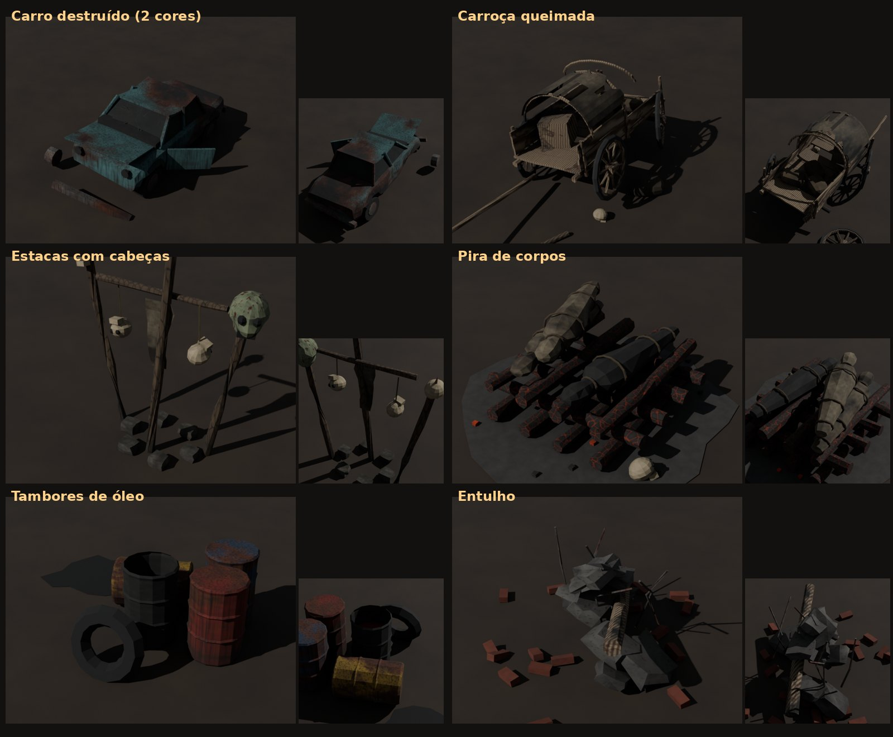
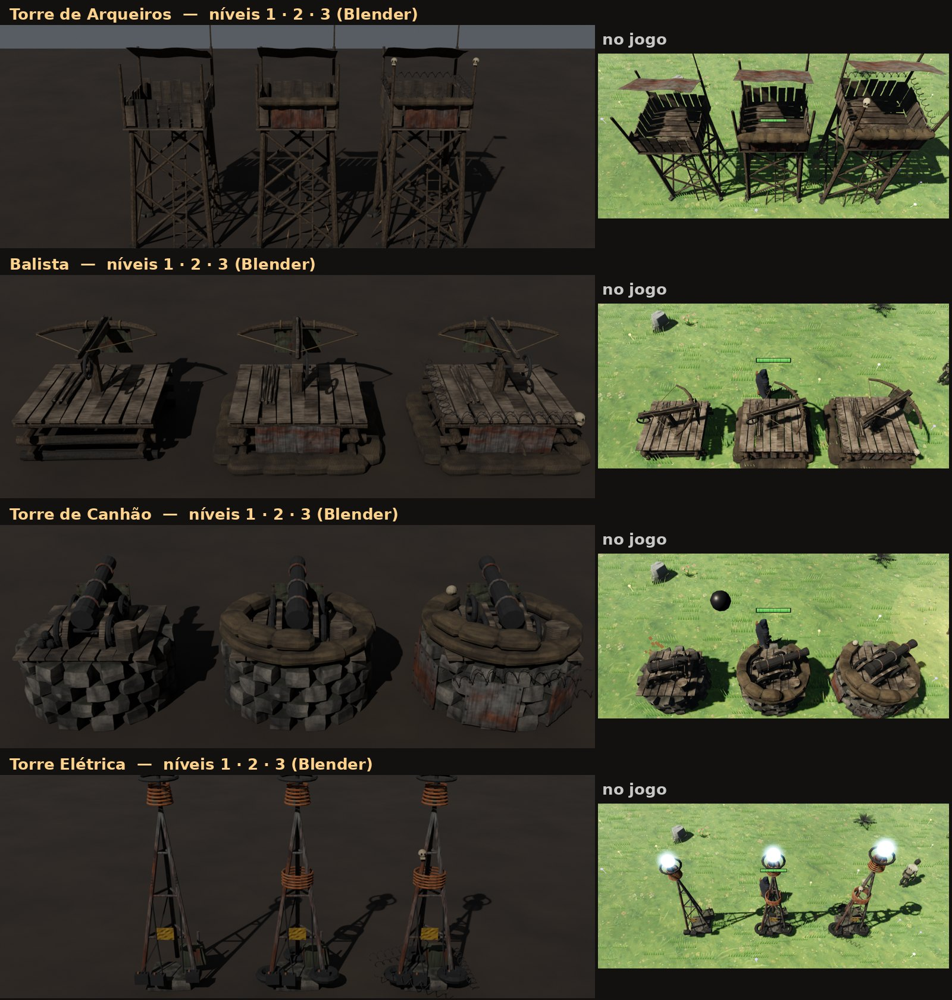
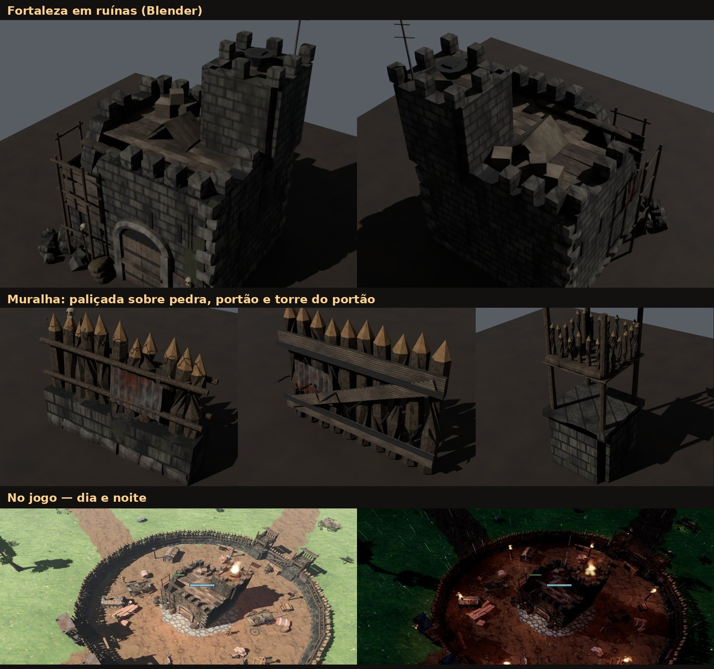
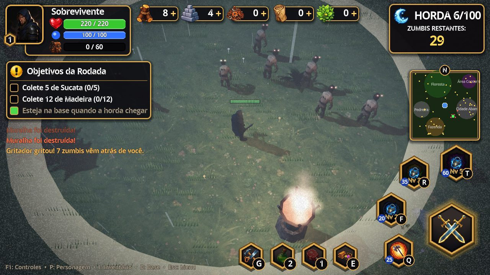
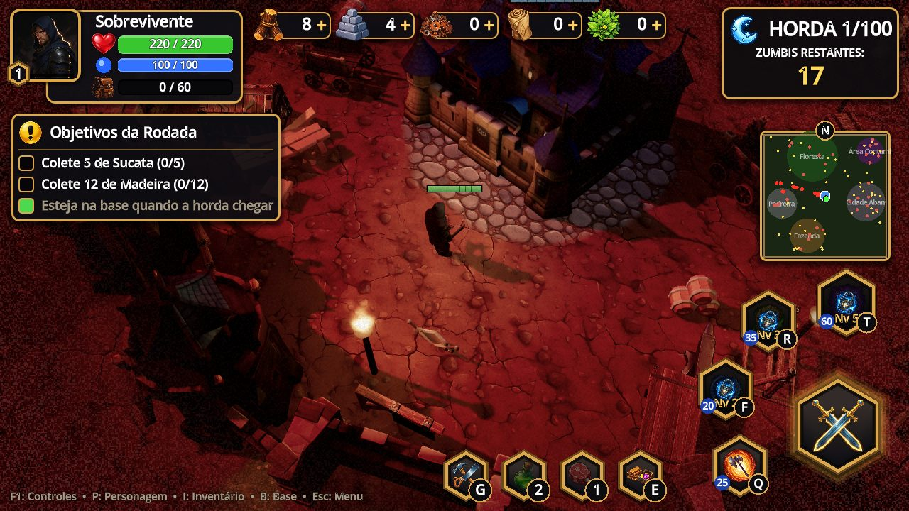

# Horda: Noites de Sobrevivência

Jogo de sobrevivência cooperativa contra hordas de zumbis (estratégia + RPG + defesa de base),
inspirado em *Night of the Dead: Aftermath* (Warcraft III). Feito em **Godot 4.3+ / GDScript tipado**.

> Estado atual: **Fase 1 — protótipo jogável** concluída.
> Arte gerada por IA no estilo Dota 2 / Warcraft III: texturas, retratos, ícones e conceitos na BytePlus ARK (Seedream);
> **modelos 3D texturizados** (herói, zumbis, fortaleza, muralhas, torres, árvores, casas...) via image-to-3D. Veja o pipeline em docs/ARQUITETURA.md.

## Jogar no navegador / celular

**https://horda-five.vercel.app** — abra no celular na horizontal. No Android (Chrome), use
"Adicionar à tela inicial" para jogar em tela cheia como app.

Celular: joystick à esquerda para andar, hexágono das espadas para atacar (mira automática), toque no
chão para ir até lá ou num inimigo para atacá-lo, **E** saqueia, **1/2** curam, pinça para zoom.
Retrato do herói = inventário • **+** nos recursos = menu da base • painel do dia = pausar
(no PC também valem as teclas I, B e Esc). Parâmetros úteis: `?touch=1` força os controles de toque no PC, `?dbg=1` mostra FPS no console.

Cada push no GitHub recompila automaticamente no Vercel (`tools/vercel_build.sh`, ~1 min).

Download da versão web: ~51 MB de dados (`index.pck`) + ~34 MB do motor (`index.wasm`, servido comprimido).
Para manter leve: texturas importadas como WebP com perda (`compress/mode=1`, qualidade 0.8; texturas
dos modelos riggados limitadas a 1024 px), animações compartilhadas entre personagens
(`kaykit_base_anims.res`, `npc_anims.res`), música em Vorbis q0 e os modelos-fonte usados só pelas
ferramentas de montagem (`tools/bake_*.gd`) fora do export (`exclude_filter` em `export_presets.cfg`).
Ao adicionar texturas novas, use o mesmo modo de compressão no `.import`.

## Como jogar (PC)

1. Abra a pasta no Godot 4.3 (ou mais novo) e pressione **F5**.
2. *Novo jogo* → escolha a dificuldade.

| Controle | Ação |
|---|---|
| WASD | Mover o herói |
| Clique direito (chão / inimigo) | Mover até o ponto / atacar alvo |
| Clique esquerdo ou Espaço | Golpe em arco na direção do cursor (também corta árvores e quebra pedras) |
| E | Saquear caixas, carros e armários |
| 1 / 2 | Comer carne / usar curativo |
| P (ou toque no retrato) | Personagem: distribuir pontos de atributo |
| I ou Tab | Inventário (mochila + armazém) |
| B | Base: reparar muros/núcleo, afiar arma, fabricar curativos |
| G | Construir: barricada, muros de pedra e de ferro, espinhos, torre de arqueiros, balista, canhão e torre elétrica (T gira, clique constrói, botão direito cancela) |
| Q / F / R / T | Habilidades: Golpe Giratório (nv 1), Investida (nv 2), Grito de Guerra (nv 3), Explosão Arcana (nv 5) |
| Roda / Z, X / C | Zoom / girar câmera / centralizar |
| F5 | Salvar (somente de dia; também salva sozinho a cada amanhecer) |
| F8 | [Depuração] avançar período do dia |
| F1 / Esc | Controles / pausa |

**100 hordas:** antes de cada horda há **2 minutos de preparação** (ou toque em "Chamar agora"). A horda
termina quando o último zumbi cai — e já começa a próxima preparação. Elites a cada 5 hordas, **chefe** a
cada 10 (atacando de todas as direções). Vencer a horda 100 = vitória.

**Defesas:** *Balista* (horda 3) atravessa a fila inteira com virotes de 22 m; *Muro de Ferro* (horda 5)
tem 1600 de vida e armadura 9; *Torre de Canhão* (horda 6) lança balas em arco que explodem em área e
atordoam; *Torre Elétrica* (horda 10) dispara um raio que salta por 5 zumbis e os paralisa.

**Equipamentos:** arma, armadura e amuleto, em 11 modelos (machado, espada, lança, adagas, martelo; couro,
malha, placas; amuletos da vida/arcano e anel do caçador) e 5 raridades — *Comum, Incomum, Raro, Épico e
Lendário* — que multiplicam os atributos e somam de 0 a 4 bônus sorteados (dano, velocidade, crítico,
armadura, vida, regeneração, movimento, energia, poder, roubo de vida). O nível do item acompanha a horda.
Chefes sempre largam Raro ou melhor, elites às vezes; caixas e esconderijos também. Na **Forja** (menu da
base, aba Forja) fabrique com recursos — Engenharia aumenta a chance de raridade. Equipe, compare e desmonte
na aba *Equipamento* do personagem (P). Dados em `data/equipment/*.tres`.

**Tecnologias:** aba *Pesquisa* no menu da base — uma pesquisa por vez, com custo e tempo (o relógio corre
inclusive durante a horda), 16 tecnologias em três ramos com pré-requisitos: **Defesa** (muros reforçados,
pontas de aço, recarga, lunetas, munição pesada, muralhas de ferro, pedreiros que consertam sozinhos),
**Economia** (ferramentas, mochilas, saqueadores, coletores que produzem recursos, oficina avançada) e
**Herói** (treinamento, medicina, foco arcano, veterano). Dados em `data/tech/*.tres`.

**Exército:** construa um **Quartel** (horda 2; 4 vagas, +2 por nível, até 12 — 8 no celular) e recrute na
aba *Exército* do menu da base: **Guarda** (tanque), **Arqueiro** (à distância, horda 3), **Bárbaro** (dano
alto, horda 4) e **Mago de Batalha** (magia em área, horda 6). Cada soldado treina alguns segundos no Quartel.
Três ordens para todo o exército — **Defender a base** (postos dentro da paliçada), **Seguir o herói** e
**Caçar zumbis** (até 65 m da base) — trocadas na aba, na pílula do topo da tela ou com **V**. Soldados usam
uma malha de navegação própria (contornam paliçada e construções e passam pelos portões); zumbis revidam e
atacam soldados próximos; mortes do exército dão metade do XP ao herói. No coop o exército é compartilhado.

**Classes:** o **Caçador** ataca com **arco** (14 m, flecha teleguiada; perto de árvores e pedras sem
inimigo na mira usa o machado para coletar). Habilidades: *Tiro Múltiplo* (Q, 5 flechas em leque, uma por
inimigo), *Armadilha de Urso* (F, nível 2, até 3 no chão: dano alto e prende por 3 s), *Chuva de Flechas*
(R, nível 3, no maior grupo ao alcance: dano contínuo e lentidão) e *Chamado da Águia* (T, nível 5, uma águia
voa com você por 20 s mergulhando nos inimigos — e revela Espreitadores). O **Cavaleiro** luta corpo a corpo
com *Golpe Giratório*, *Investida*, *Grito de Guerra* e *Explosão Arcana*. A águia, o arco e a armadilha
foram **modelados no Blender** por `tools/blender_hunter_props.py` (malhas low-poly e as animações da águia
"fly", "glide" e "dive"); rode com `blender --background --python tools/blender_hunter_props.py --
assets/models/blender` ou com o módulo `bpy` do PyPI. A pose de tiro é procedural (braços sobrepostos à
animação em `CharacterModel._apply_aim`).

**Defesas feitas no Blender:** barricada, muro de pedra, muro de ferro e armadilha de espinhos foram
modeladas à mão em `tools/blender_defenses.py` no estilo de sobrevivente improvisando — tábuas velhas,
estacas, zinco enferrujado, sacos de areia, pedra desmoronada com musgo, chapas soldadas com rebites,
pregos ensanguentados, arame farpado e crânios. Cada melhoria acrescenta peças ao modelo (objetos Lv2/Lv3
do GLB). Texturas procedurais assadas no Cycles num atlas por defesa, com oclusão embutida (5 a 9 mil
triângulos no nível 3). `python3 tools/blender_defenses.py assets/models/blender [nome] --render pasta`
gera os GLB e uma prévia dos 3 níveis.



**Cenário feito no Blender** (`tools/blender_scenery.py`): carros destruídos (2 cores; capô aberto, porta
pendurada, roda caída, vidros trincados) no lugar dos carros de caixas da cidade; carroça queimada (rodas
raiadas, lona rasgada, carga revirada) no lugar das carroças; estacas com cabeças à beira das estradas e na
Área Contaminada; piras de corpos (duas ardem à noite, com fogo e luz que revela Espreitadores); tambores de
óleo enferrujados (dois com fogueira acesa à noite) e pilhas de entulho com vergalhões na cidade.



**Torres feitas no Blender** (também em `tools/blender_defenses.py`, com peças por nível): atalaia de
troncos com parapeito de tábuas e meia-água de zinco; balista sobre berço de dormentes; canhão de ferro numa
carreta sobre bastião de pedra; torre elétrica de canos enferrujados com bobinas de cobre, baterias de carro e
gerador. A arma da balista e do canhão é o objeto `Turret` do GLB e gira para o inimigo mais próximo
(`Building._update_turret`, também no cliente do coop).



**Fortaleza e muralha feitas no Blender** (`tools/blender_scenery.py`): a fortaleza virou um forte de pedra em
ruínas adaptado pelos sobreviventes — alvenaria suja com musgo e fuligem, ameias falhadas, canto da frente
desmoronado e remendado com andaime, tábuas e zinco, portão em arco reforçado com ferro, deck com lona e
caixotes e uma torre de vigia com fogueira-farol (a luz que revela Espreitadores; marcadores `Beacon` e
`GateLight` no GLB). A muralha da base é uma paliçada de troncos apontados sobre base de pedra (duas
variações), com portões de estacas e torres de madeira com tochas. Os modelos antigos que estes substituíram
ficam fora do export (só servem de reserva no editor).



**Inimigos especiais:** a partir da horda 4 surge o *Zumbi Explosivo* (incha e explode ao alcançar o alvo,
arrasando muros; abatido, explode ferindo os zumbis ao redor), na 7 o *Cuspidor* (cospe ácido de 10 m,
inclusive por cima dos muros, deixando poças corrosivas, e recua se você se aproximar) e na 9 o *Saltador*
(salta até 10 m sobre a presa e pula os muros durante o cerco). Cada estreia é anunciada na tela.

**Terror na escuridão:** à noite os zumbis têm **olhos que brilham** (vermelhos; brancos no Espreitador,
amarelos no Gritador). Na horda 6 estreia o *Espreitador*: fora da luz fica quase invisível, torres e soldados
não o enxergam e o mapa não o mostra; caça o herói e o primeiro golpe ao sair do escuro é dobrado. A lanterna
do herói (9 m), tochas, a fortaleza e os **Braseiros** o revelam. Na horda 8, o *Gritador*: mantém distância e
grita, atraindo todos os zumbis num raio de 22 m, enfurecidos (30% mais rápidos) — mate-o primeiro. O
**Braseiro** (horda 3, sem ataque) ilumina 12 m, revela Espreitadores e deixa os zumbis na luz 30% mais
lentos. Em algumas noites cai **névoa densa**: as torres enxergam 30% menos e o minimapa só mostra os zumbis a
até 28 m do herói. Cada **lua de sangue** traz um chefe diferente, em ciclo: *Abominação*, *Rainha dos Gritos*
(grita e ergue zumbis), *Sombra Faminta* (Espreitador gigante) e *Carniceiro Saltador*.



**Tutorial e configurações:** a primeira partida solo traz um tutorial guiado de 7 passos (mover, coletar,
derrotar um zumbi, voltar à base, construir, usar habilidade, chamar a horda) com o relógio parado e bônus no
final — pode ser pulado e refeito em *Configurações*. Configurações (menu principal e pausa): qualidade gráfica
Baixa/Média/Alta (sombras, antisserrilhado, resolução 3D, grama e decoração), limite de FPS (30/60/livre),
contador de FPS, números de dano e volumes.

**Coop online (até 4 jogadores):** menu *Jogar em grupo (coop)* → *Criar sala* gera um código de 5 letras
(e um link de convite `?sala=CODIGO`); os amigos entram pelo navegador do celular ou PC com o código. Base,
armazém, construções e pesquisas são compartilhados; cada jogador tem o próprio herói, nível, atributos e
equipamento, e o XP vai para quem matou. Saques no chão são de quem pegar primeiro. O anfitrião simula o
mundo (zumbis, hordas, torres, tempo). Conexão WebRTC direta entre os navegadores, com sinalização pelo
servidor público do PeerJS (sem servidor próprio); em redes móveis muito restritas a conexão pode falhar.
Partidas coop não são salvas. No PC (sem navegador), o coop usa IP + porta 24680 (ENet).

**Habilidades:** gastam **energia** (barra azul, regenera 6/s) e têm recarga. *Golpe Giratório* acerta
tudo ao redor; *Investida* avança 8 m invulnerável atordoando quem estiver no caminho; *Grito de Guerra*
cura 30% da vida e dá +6 de armadura por 8 s; *Explosão Arcana* cai sobre o maior grupo de zumbis
num raio de 14 m e atordoa os sobreviventes. Novas habilidades liberam ao subir de nível. Dados em
`data/skills/*.tres`.

**Atributos:** cada nível dá **3 pontos** (selo "+" dourado no retrato). *Força* +5% dano e +4 de carga;
*Agilidade* +4% velocidade de ataque, +2% movimento e +1% crítico; *Vitalidade* +18 de vida e +0,4 vida/s;
*Inteligência* +8 de energia, +6% poder das habilidades e -2% de recarga; *Engenharia* +6% vida das
construções e +6% dano de torres e armadilhas. *Redistribuir* devolve os pontos por sucata. Valores em
`data/config/attributes.tres`.

**Na preparação:** explore as regiões (Floresta, Pedreira, Cidade Abandonada, Fazenda, Área Contaminada),
mate zumbis, colete madeira/pedra, saqueie e volte à base — a mochila (60 de peso) é guardada
automaticamente ao entrar. Ao entardecer soa o aviso; à noite a horda vem pelas bordas do mapa,
quebra a paliçada e tenta destruir o **Núcleo**. Sobreviva até o amanhecer: o sol queima os zumbis restantes.
Se o herói cair, renasce na base (e a mochila fica no chão onde morreu). Se o Núcleo cair, fim de jogo.

## Som

Efeitos, músicas e ambientes **CC0** do OpenGameArt (créditos em
[assets/sounds/CREDITS.md](assets/sounds/CREDITS.md)), com 3 a 17 variações por efeito sorteadas com leve
variação de tom. Música dinâmica com crossfade: menu, preparação (2 faixas alternadas), horda (2 faixas),
chefe e derrota; ambiente de pássaros de dia, grilos à noite e um ambiente sombrio perto do cemitério.

### Atmosfera de terror

`scripts/world/day_night_visuals.gd` controla luz, céu e neblina: dia nublado e dessaturado, entardecer cor
de sangue e noite escura com neblina, onde o herói carrega uma **lanterna** (círculo de luz quente que
tremula). Na rodada do chefe vem a **lua de sangue** (céu, lua e neblina vermelhos); em parte das noites
(sempre na primeira) há **tempestade** com chuva, relâmpagos e trovões — sorteada pela rodada, então todos no
coop veem o mesmo clima. À noite tocam uivos, gemidos, gritos distantes e sussurros (que não param na área
contaminada); de dia, corvos. Na tela: vinheta escura, granulado de filme, clarão dos relâmpagos e, com a
vida abaixo de 35%, borda vermelha pulsando com batimento cardíaco. Zumbis mortos deixam poças de sangue.
O chão é dividido em 8×8 blocos para que a lanterna e as tochas iluminem mesmo no renderizador web (que
limita as luzes por objeto). Para revisar o visual: `xvfb-run godot res://tests/atmo_probe.tscn -- <pasta>`.


Volume de Música, Efeitos, Ambiente e Interface no menu de pausa (salvo em `user://settings.cfg`). O "ouvido" do jogo fica
no herói (não na câmera alta), com limitador no canal principal. Para medir o volume de uma luta:
`godot --headless --audio-driver Dummy res://tests/audio_capture.tscn -- luta.wav`.

## Assets de terceiros (CC0)

Além da arte gerada por IA, o mapa usa pacotes **CC0** baixados do itch.io (créditos em
[assets/third_party/CREDITS.md](assets/third_party/CREDITS.md)): vegetação, pedras e árvores do
*Stylized Nature MegaKit* (Quaternius), cemitério do *Halloween Bits* (Kay Lousberg), objetos de cenário
do *Fantasy Props* e *Medieval Village MegaKit* (Quaternius) e os **esqueletos** animados do *KayKit
Skeletons* + *Character Animations* (Kay Lousberg), que entram na horda: *Esqueleto* (horda 2),
*Ladino* (5), *Guerreiro* (8) e *Mago* (12, ataca de longe). Também: **escolha de herói** no "Novo jogo"
(Caçador e **Cavaleiro de armadura dourada**, só heróis no estilo do jogo; os soldados do exército usam esses mesmos modelos com outras cores),
**sobreviventes** animados na base (ferreiro, vigias, conversa, andarilho — *Modular Character Outfits* +
*Universal Base Characters* + *Universal Animation Library*, Quaternius), que se escondem na fortaleza
durante a horda, e **ruínas** do *KayKit Dungeon Pack* na cidade, pedreira e floresta. O Cavaleiro veio de um modelo pronto enviado pelo
jogador (480 mil triângulos, sem esqueleto): `tools/render_views.tscn` tira 4 vistas e o
`tools/tripo_pipeline.py nome:frente.jpg,esquerda.jpg,costas.jpg,direita.jpg` o refaz leve (15 mil
triângulos) com esqueleto e as animações padrão. Para baixar de novo:

```bash
python3 tools/itch_fetch.py /tmp/itch quaternius/stylized-nature-megakit kaylousberg/kaykit-skeletons ...
python3 tools/import_third_party.py /tmp/itch/extraido      # copia só os modelos usados
godot --headless --script res://tools/bake_kaykit.gd         # esqueletos e heróis com armas e animações
godot --headless --script res://tools/bake_npcs.gd           # sobreviventes (cabeça + roupa + cabelo + animações)
xvfb-run godot res://tools/render_portraits.tscn            # retratos dos heróis
```

## Testes

```bash
# Teste automatizado da Fase 1 (gera o mundo, combate, coleta, saque, serviços, noite, amanhecer, save)
godot --headless res://tests/smoke_test.tscn

# Capturas de tela (precisa de display; no Linux sem GPU: xvfb-run + OpenGL)
xvfb-run godot --rendering-driver opengl3 --rendering-method gl_compatibility res://tests/screenshot.tscn -- /tmp/shots
```

```bash
# Coop: anfitrião e cliente em dois processos (ENet local)
GODOT=godot tools/run_coop_test.sh
```

## Regenerar arte e sons

```bash
ARK_API_KEY=... python3 tools/gen_image.py tools/art_prompts.json   # só gera o que estiver faltando
python3 tools/oga_fetch.py /tmp/oga <slugs...>                      # sons/músicas CC0 do OpenGameArt (confere a licença)
python3 tools/build_audio.py /tmp/oga                                # converte para assets/sounds, music, ambient
```


Veja [docs/ARQUITETURA.md](docs/ARQUITETURA.md) para a arquitetura e o roteiro das próximas fases.
